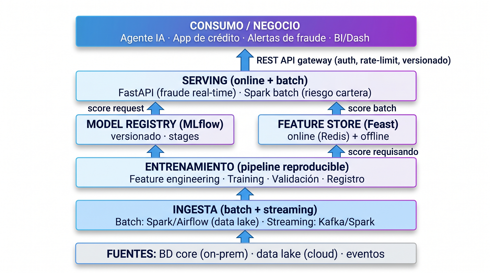

# 01 · Arquitectura de referencia

## 1. Contexto y objetivos de diseño

Organización bancaria con infraestructura analítica en la nube y storage/BD **on-premise**. Se exige que
la solución:

- **Escale** y se **mantenga** en el tiempo, acompañando cambios de negocio.
- Entrene y evalúe **dos modelos** (riesgo y fraude) sobre fuentes heterogéneas.
- Gestione el **ciclo de vida completo** del modelo.
- Exponga resultados de forma **gobernada** para ser consumidos por aplicaciones y un **agente IA**.
- Contemple **monitoreo y control** en producción.

Los principios rectores del diseño son: **reproducibilidad, gobernanza, observabilidad y time-to-value
progresivo**.

## 2. Vista de capas (end-to-end)

## 3. Componentes y responsabilidades

| Componente | Tecnología propuesta | Responsabilidad |
|---|---|---|
| Ingesta batch | Spark + Airflow | Carga diaria/semanal desde BD core y data lake |
| Ingesta streaming | Kafka + Spark Structured Streaming | Eventos transaccionales en tiempo real |
| Feature store | Feast | Features versionadas, consistentes online/offline |
| Registro | MLflow Model Registry | Versionado, stages (Staging/Production/Archived) |
| Entrenamiento | Python (scikit-learn, XGBoost/LightGBM) | Experimentación y entrenamiento |
| Serving online | FastAPI + Kubernetes | Fraude en tiempo real (<100ms) |
| Serving batch | Spark (EMR/Dataproc) | Re-scoreo de cartera de riesgo |
| API gateway | Kong / API Gateway cloud | Auth (OAuth2/mTLS), rate-limit, versionado |
| Monitoreo | Evidently AI + Great Expectations + Prometheus/Grafana | Drift, calidad de datos, alertas |
| Orquestación | Airflow | DAGs de pipeline y retraining |
| Infra | Terraform + Kubernetes | IaC, entornos reproducibles |

## 4. Flujo de datos de los dos modelos

### Modelo de Riesgo (batch + on-demand)
1. Datos transaccionales, de producto y sociodemográficos → data lake (offline).
2. Feast materializa features → entrenamiento → validación (AUC, KS, PSI).
3. Registro en MLflow → promoción a Production.
4. Scoring **batch** mensual/semanal de la cartera + scoring **on-demand** vía API cuando el cliente solicita producto.

### Modelo de Fraude (streaming + real-time)
1. Eventos transaccionales → Kafka.
2. Enriquecimiento con features online (Feast + Redis) → scoring en línea.
3. Score de anomalía → umbral → alerta a analista (con explicación SHAP).
4. Feedback loop: confirmaciones de fraude alimentan el retraining supervisado.

## 5. Entornos

| Entorno | Propósito | Datos | Automatización |
|---|---|---|---|
| dev | Desarrollo y experimentación | Sintéticos/anónimos | CI (lint, tests unitarios) |
| staging | Validación pre-producción | Subconjunto real anonimizado | CI + shadow deployment |
| prod | Producción | Datos reales | CD gobernado con aprobación |

Cada entorno replica la pila vía Terraform + Helm, garantizando paridad.

## 6. Escalabilidad, performance y costo

- **Fraude:** serving stateless en K8s con autoscaling horizontal (HPA) por latencia/throughput.
- **Riesgo batch:** Spark con particionado por cliente y caching de features.
- **Costo:** separar clústeres batch (efímeros, spot) del serving (siempre encendido). Feature store online en Redis para latencia baja.
- **Performance:** objetivo P95 <100ms en scoring online de fraude; batch de cartera completo en ventana nocturna.
