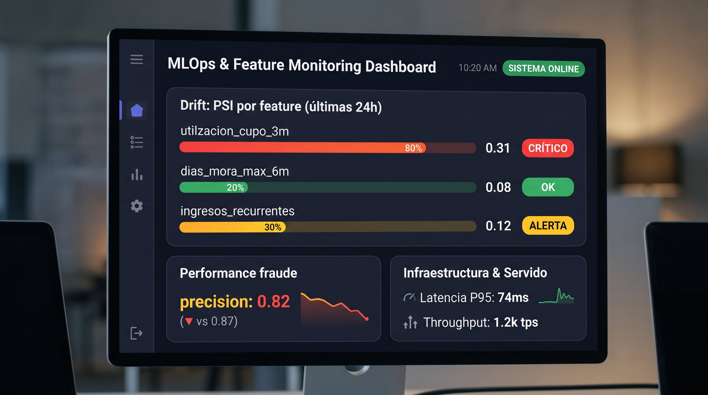

# 08 · Métricas clave, valor de negocio y mockups

## 1. Métricas clave de la solución

### Técnicas (por modelo)

| Modelo | Métrica | Objetivo |
|---|---|---|
| Riesgo | AUC / KS / Gini / PSI / Calibración | Discriminación y estabilidad |
| Fraude | Precision / Recall / PR-AUC / FPR / Latencia P95 | Balance y operación en línea |

### De negocio

| Métrica | Definición | Valor esperado |
|---|---|---|
| Pérdidas por fraude evitadas | $ fraude detectado / $ fraude total | ↑ reducción de pérdida |
| Tasa de falsos positivos | clientes legítimos bloqueados | ↓ fricción |
| Aprobación de riesgo | % decisiones correctas / mora evitada | ↓ mora, ↑ otorgamiento sano |
| Time-to-value | tiempo entrenar→producción | ↓ semanas |
| Cobertura de monitoreo | % modelos en prod con drift alertado | 100% |

## 2. Valor que aporta al negocio

- **Riesgo:** mejores decisiones de otorgamiento y cupos, menor mora, precios ajustados a riesgo.
- **Fraude:** detección en tiempo real, menos pérdida, mejor experiencia (menos FP).
- **Agente IA:** decisiones explicadas y accionables para analistas y clientes internos.
- **Plataforma:** capacidad de escalar a nuevos modelos y casos de uso de forma sostenible.

## 3. Mockups de salidas técnicas

### 3.1 Respuesta API de riesgo (on-demand)

    {
      "cliente_id": "CLI-1000231",
      "modelo": "riesgo-financiero",
      "version": "2.1.0",
      "score": 0.18,
      "bucket": "bajo",
      "umbral": 0.40,
      "explicacion": {
        "top_factores": [
          {"feature": "utilizacion_cupo_3m", "impacto": +0.06, "tendencia": "en aumento"},
          {"feature": "dias_mora_max_6m", "impacto": +0.03, "tendencia": "estable"},
          {"feature": "ingresos_recurrentes", "impacto": -0.05, "tendencia": "estable"}
        ]
      },
      "timestamp": "2026-11-11T09:37:00Z"
    }

### 3.2 Alerta de fraude

    {
      "transaccion_id": "TX-9988123",
      "modelo": "fraude-anomalias",
      "version": "1.4.2",
      "score_anomalia": 0.93,
      "score_fraude": 0.71,
      "decision": "REVISAR",
      "razones": ["monto 8x sobre mediana", "ubicacion distante 900km en 10min", "dispositivo nuevo"],
      "accion_sugerida": "bloquear y contactar cliente",
      "timestamp": "2026-11-11T09:37:54Z"
    }

### 3.3 Vista de monitoreo (dashboard)

## 4. Mejoras y features a futuro

- AutoML guiado para experimentación más rápida.
- Explicaciones en lenguaje natural (LLM) para el agente IA.
- Detección de fraude en redes/grafos (graph ML) para anillos de fraude.
- Scoring de riesgo en streaming (no solo batch) para alertas tempranas.
- Online learning con monitoreo reforzado para adaptación continua.
- Data contracts (esquemas) para robustecer la ingesta.
